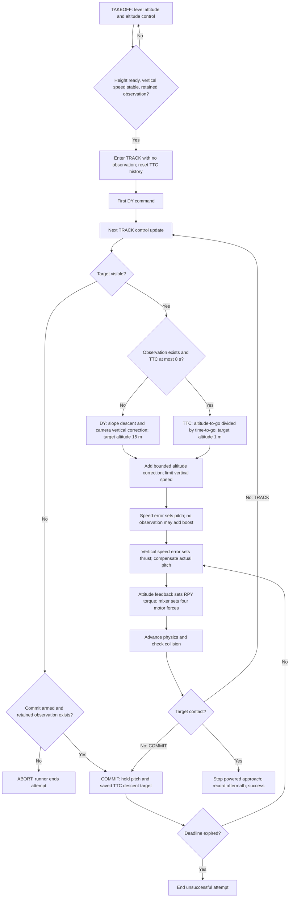

# Slant trajectory algorithm: takeoff completion to red-box contact

I want to understand which sensors and inputs influence the output, when they
influence it, and why. This document traces the current implementation as a
baseline for better control design: from finishing takeoff to contacting the
red box, including who changes roll, pitch, yaw, and throttle.

Reviewed on 2026-10-11. Equations describe the current working tree, using
[`configs/scenario.yaml`](../configs/scenario.yaml) and inherited defaults.
This is an explanation of existing behavior; it changes no flight algorithm.

## 1. What produces the slant path?

The controller combines **visual time-to-contact (TTC) estimation, a two-mode
vertical-velocity planner, and cascaded velocity/attitude control**. It does
not calculate a geometric line between the drone and the target's world
position, or follow a stored series of waypoints.

Positive pitch is nose-down in this vehicle model. Tilting the rotor thrust
forward accelerates the drone along world +X. A negative vertical-velocity
target makes it descend. Together, forward travel and descent produce the
slant path. The path changes as the speed, camera observations, and altitude
estimate change; it is not guaranteed to be a straight line.

There are two TRACK modes:

- **DY:** while TTC is absent or greater than 8 s, request descent using a
  configured drop-per-forward-metre slope, then adjust it using the target's
  vertical image position and altitude error.
- **TTC:** when an observation exists with TTC at most 8 s, request the
  vertical speed needed to reach the configured 1 m impact altitude within
  that time, with an additional altitude-error correction and speed limits.

Pitch follows the forward-speed error in both modes. Camera vertical error
changes descent through thrust in DY; it does not directly change pitch.
Roll and yaw targets remain zero, so this is primarily an X/Z-plane exercise.

## 2. Sensor and input influence

Here `z` is estimated world-up altitude, `vz` is estimated world-up speed
(negative means descent), `vx` is world-X speed, and `theta` is measured pitch.

| Sensor/input | Actual source | When used | Influence and reason |
| --- | --- | --- | --- |
| RGB image and red bbox | PyBullet camera, or Godot shared-memory RGB frame; largest HSV red contour after mask opening, minimum contour area 20 px² | Camera updates during takeoff and TRACK | Visibility determines whether tracking can continue. Box scale drives TTC; height arms COMMIT; vertical centre drives DY correction. |
| Bbox scale `sqrt(width * height)` and its filtered growth | `BboxTtcTracker` | TRACK/TTC gate and COMMIT deadline | Estimates time-to-go without metric target size or range. A single frame cannot supply growth. |
| Bbox vertical centre and measured pitch | `bbox_alignment_angles()` | Visible target in DY only | Converts vertical pixel error to an angle and adds pitch to approximate world-relative target direction. Positive compensated error commands more descent. |
| Barometer altitude | Noisy, biased, optionally drifting simulated altitude; filtered at the sensor adapter | Vertical fusion whenever a barometer sample arrives | Corrects integrated altitude and vertical-speed drift. Guidance receives the fused estimate rather than the raw barometer output. |
| World-up linear acceleration | Synthetic `VerticalImu`, based on successive true vertical velocities plus noise/bias | Every physics tick | Predicts `vz` and `z` between barometer samples. This is already gravity-compensated world acceleration, not a raw body accelerometer. |
| Forward speed `vx` | `p.getBaseVelocity(drone)[0][0]` | TRACK control updates | Speed error sets pitch; DY slope also uses it. This is simulator ground truth, not a camera/IMU speed estimate. |
| Euler roll/pitch/yaw and body angular rates | Ideal PyBullet `read_imu()` | Attitude control updates; pitch also used by guidance | Attitude error produces body torques; rates damp rotation. Actual pitch compensates collective thrust for tilt. |
| Impact altitude, desired speed, gains and limits | Mission/runtime configuration | Planning and control updates | Defines the objective and controller authority. Impact altitude is supplied, not visually estimated. |
| `commit_ready`, retained observation, current time | TTC tracker and runner | Target-loss transition | Determines COMMIT versus ABORT and the blind-flight timeout. |
| Contact event | PyBullet contact, or Godot collision event | After a physics step | Ends the powered approach on actual contact. TTC reaching zero is not the success condition. |

Target world position and metric cube size are simulation setup, not inputs
to guidance. Camera intrinsics **do** matter for DY angular correction even
though bbox-growth TTC does not require metric target geometry. Horizontal
image error `dx` is available for diagnostics but does not steer roll or yaw.

### Update timing and held data

Default physics/fusion is 240 Hz, guidance and attitude control are 120 Hz,
camera polling is 30 Hz, and barometer sampling is nominally 40 Hz. The runner
samples sensors, handles a due camera frame, then performs a due control update,
then advances physics. Guidance therefore commonly reuses the same camera
observation across several control ticks. Motor commands are held between
control updates, while the actuator model advances every physics tick.

The barometer uses an elapsed-time gate, so its actual cadence is quantized to
physics steps. `imu_sample_hz` is configurable metadata but does not schedule
`VerticalImu.sample()` independently: the runner calls it every physics tick.
The attitude IMU is read separately at control updates.

For Godot, a missing shared-memory frame leaves the previous visibility,
observation, and alignment state unchanged. There is no camera-age timeout in
guidance. A received frame with no red detection explicitly reports target loss.

## 3. Takeoff completion and the first slant command

TAKEOFF commands zero pitch and uses altitude control. The transition requires:

```text
estimated z > takeoff_altitude - altitude_tolerance = 14.8 m
abs(estimated vz) < vertical_speed_tolerance = 0.5 m/s
tracker.last_observation exists
```

This is a lower altitude threshold, not a symmetric band around 15 m.
`last_observation` is retained history; it need not be from the current frame,
and current visibility is not explicitly checked in this transition.

On transition, guidance resets the forward PID and emits its first TRACK
command with `observation=None`. The runner then resets TTC history and commit
readiness. Growth accumulated during vertical takeoff is discarded because it
does not describe the new approach. The first TRACK command consequently uses
DY; if the target is visible it also gets the configured no-observation pitch
boost. The next camera detection seeds scale, and later growing detections can
produce TTC. If the target is lost, the next TRACK update handles that loss.

## 4. TTC estimation: what the camera really measures

For each detected box, define `s = sqrt(width_px * height_px)`. The tracker
uses an alpha-beta filter on apparent scale and scale growth:

```text
dt = current_camera_update_time - previous_camera_update_time
s_pred = s_hat + growth_hat * dt
residual = s_measured - s_pred
s_hat = s_pred + alpha * residual          alpha = 0.85
growth_hat = growth_hat + beta * residual / dt    beta = 0.05
TTC = s_hat / growth_hat
```

No observation is returned on the first detection, nonpositive `dt`, or
filtered growth at most `0.01 px/s`. Raw scale-difference TTC is recorded for
diagnostics; guidance uses filtered TTC. A box height of at least
`480 * 0.1 = 48 px` latches `commit_ready` until reset, even if that frame
cannot produce TTC. Missing detections return `None` but preserve the tracker
history and its last successful observation.

The principle is optical expansion: for approximately constant projected
target size, apparent scale grows as range falls, so scale/growth approximates
remaining contact time at the current closing rate. Drone acceleration,
changing viewpoint, cube silhouette changes, camera rotation and edge clipping
can change scale without equivalent range change. The implementation filters
growth but does not explicitly reject those effects or estimate TTC confidence.

## 5. TRACK equations: when and why commands change

### DY mode: slope plus vertical visual correction

DY is selected when `observation is None` **or** `TTC > 8 s`:

```text
vz_base = -max(1.5, 0.50 * max(0, vx))       [m/s]
z_target = 15 m
```

The nominal slope is 0.50 m down per metre forward. If the vehicle perfectly
followed only that slope, it would descend at `atan(0.50) = 26.6°` below
horizontal. This path angle is different from the drone pitch angle. At low
forward speed the minimum 1.5 m/s descent dominates instead.

The camera geometry computes vertical centre offset `dy_px`, converts it with
image dimensions and FOV into `dy_deg`, and forms:

```text
e_camera = dy_deg + degrees(theta)
if e_camera is missing/nonfinite or abs(e_camera) <= 1 degree:
    camera_correction = 0
else:
    effective_error = e_camera - sign(e_camera) * 1 degree
    camera_correction = clamp(-0.20 * effective_error, -2, +2)  [m/s]
vz_plan = vz_base + camera_correction
```

Thus a target below the compensated view makes the command descend faster;
a target above it reduces descent or adds upward correction. The deadband
prevents small image movements from continually changing the descent target.
Mounting-angle compensation is incomplete: the helper adds measured pitch,
but does not receive `camera_look_down_deg`. The default mounting angle is zero.

### TTC mode: altitude-to-go divided by time-to-go

An existing observation with `TTC <= 8 s` selects TTC mode:

```text
time_to_go = max(TTC, 0.2 s)
z_target = 1 m
vz_plan = clamp((1 - z) / time_to_go, -5.5, +3.0)  [m/s]
camera_correction = 0
```

This recalculates the needed descent on every control update. A shorter TTC
or greater altitude-to-go requests faster descent. Camera DY correction stops
completely in this mode. The 8 s gate has no hysteresis; estimates crossing it
can repeatedly switch between DY and TTC.

### Shared altitude correction and final vertical target

Both modes add a separate position correction:

```text
position_correction = clamp(0.8 * (z_target - z), -2, +2)  [m/s]
vz_target = clamp(vz_plan + position_correction, -5.5, +3.0)
```

In DY this pulls toward takeoff altitude while the slope asks for descent.
As the drone falls below 15 m it therefore offsets part of the requested
descent. In TTC it adds descent toward the 1 m impact altitude on top of the
time-to-go calculation. The final controller is consequently more than the
simple `(impact_altitude - z) / TTC` law.

Examples at the same measured `z = 15 m`, using scenario values:

| Inputs | Resulting `vz_target` | Reason |
| --- | --- | --- |
| No observation, `vx=0`, camera error inside deadband | -1.5 m/s | Minimum DY descent; zero position correction. |
| TTC=12 s, `vx=10`, camera error inside deadband | -5.0 m/s | TTC is above the gate; slope gives `-0.5 * 10`. |
| TTC=12 s, `vx=10`, compensated camera error=+20° | -5.5 m/s | Camera adds -2 m/s to -5; final descent cap clips -7. |
| TTC=6 s | approximately -4.33 m/s | `-14/6` plus position correction -2. |
| TTC=1 s | -5.5 m/s | Planner and final target saturate at the descent limit. |

Limits bound requests, not guaranteed physical speeds or ground clearance.

## 6. Who changes roll, pitch, yaw and throttle?

| Output | Owner | Feedback | What changes it |
| --- | --- | --- | --- |
| Roll target | Runner default argument to `AttitudeController` | Measured roll and roll rate | Target always 0 rad; attitude controller corrects deviations. No bbox steering. |
| Pitch target | `StrikeGuidance` forward-speed PID | True world-X speed | TRACK speed error; optional no-observation boost. COMMIT holds the most recent pitch target. |
| Yaw target | Runner passes `yaw_target=0.0` | Measured yaw and yaw rate | Target always 0 rad; wrapped-angle error corrects heading deviations. |
| Collective thrust, analogous to throttle | `StrikeGuidance` vertical-speed PID | Fused `vz` and measured pitch | Descent target, velocity error, hover baseline and tilt compensation. |
| Body torques | `AttitudeController` | Euler attitude and body rates | Converts RPY target errors into roll/pitch/yaw torque requests. |
| Four motor thrusts/RPM | `PhysicsEngine` | Actuator and battery model | Mixes collective thrust and torque; applies motor limits, battery voltage and motor lag. |

### Pitch is speed control, not a fixed 20° approach

The shared PID implementation is `Kp * error + Ki * integral - Kd * rate`.
The forward loop passes `rate=0`, so its configured derivative gain has no
effect; with default zero integral gain it acts as proportional control:

```text
pitch_base = clamp(0.03 * (13 - vx), 0, radians(20))
pitch_target = pitch_base
if target_visible and observation is None:
    pitch_target = min(radians(25), pitch_base + radians(5))
```

At `vx=0`, base pitch saturates at 20°; absent TTC adds 5° in the scenario.
At `vx=10`, base pitch is 0.09 rad, approximately 5.16°. At or above 13 m/s,
base pitch is zero; no negative pitch is requested to actively brake overspeed.
The boost condition is specifically **no observation**: a 12 s observation
uses DY but gets no boost. `nominal_pitch_deg` is present in configuration but
is not read by this TRACK calculation. Plain `MissionConfig`/`StrikeConfig`
defaults have a zero boost; `configs/scenario.yaml` explicitly supplies 5°.

### Collective thrust controls vertical velocity

With default vertical gains `(1, 0, 0)`:

```text
vertical_force = mass * gravity + 1.0 * (vz_target - vz)
collective_thrust = vertical_force / max(cos(theta), 0.5)  [N]
```

A drone descending too slowly gets less vertical force; descending too fast
gets more. Dividing by the cosine compensates for the measured tilt, because
tilted rotor thrust has a smaller world-up component. It uses actual pitch
rather than commanded pitch to account for attitude lag. Roll tilt is not
included in this compensation. Guidance can request negative thrust; the
runner clamps per-motor collective force to zero and the motor maximum.

### Attitude control and motor allocation

The attitude loop converts target errors into torque with rate damping:

```text
tau_roll  = 0.002 * (0 - roll) - 0.001 * roll_rate
tau_pitch = 0.008 * (pitch_target - pitch) - 0.006 * pitch_rate
tau_yaw   = 0.001 * wrap_angle(0 - yaw) - 0.0005 * yaw_rate
```

These are torque requests, not RPY PWM channels. The runner divides total
thrust by four, bounds it, and maps it to collective PWM:

```text
F_collective_motor = clamp(collective_thrust / 4, 0, F_max)
PWM = 1000 + 1000 * sqrt(F_collective_motor / F_max)  [microseconds]
```

`PhysicsEngine` maps PWM back to force and uses the pseudoinverse of the rotor
torque-allocation matrix to add four motor corrections for the torque request.
It uniformly reduces torque corrections if any motor would exceed its limits.
Motor targets pass through battery voltage/current limits and first-order RPM
lag (default motor time constant 0.05 s). Actual thrust is proportional to
RPM². The physical path therefore lags commanded pitch/descent and is also
affected by gravity, drag, wind and enabled force models.

## 7. Target loss, terminal approach and collision

TRACK continues using camera observations while the target remains visible;
COMMIT is not required for success. Direct contact in TRACK also succeeds.

When the target disappears, guidance checks `commit_ready and last_observation`:

- If false, enter ABORT. Guidance requests zero pitch and vertical damping,
  but the runner finishes the attempt before applying another flight-control
  cycle. This runner does not execute a recovery or landing maneuver.
- If true, enter COMMIT. Hold the pitch from the most recent TRACK command.
  Hold the vertical target saved by the most recent TRACK update whose TTC
  passed the 8 s gate. Keep updating collective thrust from fused vertical
  velocity and measured pitch; thrust is not frozen.

COMMIT deadline is `now + tracker.last_observation.ttc_s + 5 s`. The retained
tracker observation can be older than the final camera frame and need not have
passed the 8 s gate. If TRACK never used an activated TTC, no saved descent
target exists and COMMIT uses `0 m/s`. The pitch and descent target can also
come from different TRACK updates. COMMIT ignores later camera reacquisition.
Expiration is checked before the next physics step and ends the attempt.

After each physics step, the runner checks target contact. With PyBullet RGB,
it uses `getContactPoints(drone, cube)`. With Godot RGB, the cube's PyBullet
collision is disabled and a Godot target-collision event supplies contact.
On contact it records incoming speed, sets the post-impact timer, and removes
collective thrust on subsequent physics steps and torque at the next control
update. Motor RPM decays through the actuator model. It records the aftermath
for 3 s, then reports success; there is no minimum impact-speed requirement.

## 8. Decision flow



Global simulation timeout, Godot obstacle collision and operator stop can
also end an attempt without target contact.

## 9. Sensor-to-actuator sequence

```mermaid
sequenceDiagram
    participant W as Physics / world
    participant R as Simulation runner
    participant E as Vertical estimator
    participant V as Camera / detector / TTC tracker
    participant G as StrikeGuidance
    participant A as AttitudeController
    participant M as PhysicsEngine / motors

    loop Physics tick: default 240 Hz until contact
        R->>W: Read altitude and vertical velocity
        R->>E: Noisy vertical acceleration, dt, optional barometer sample
        E-->>R: Fused z and vz
        opt Camera poll due: default 30 Hz
            R->>V: RGB frame and current simulation time
            V-->>R: Visibility, bbox, TTC, retained observation, commit readiness
            R->>R: Compute vertical bbox angle plus measured pitch
        end
        opt Control update due: default 120 Hz
            R->>G: z, vz, true vx, measured pitch, visual state, time
            alt Takeoff ready
                G->>G: Enter TRACK; calculate first DY command without TTC
                G-->>R: Pitch, thrust, reset_ttc flag
                R->>V: Reset tracker history
            else TRACK and target visible
                alt TTC exists and at most 8 s
                    G->>G: Plan altitude-to-go / TTC; save corrected descent target
                else TTC absent or above 8 s
                    G->>G: Plan slope descent plus camera correction
                end
                G->>G: Speed loop sets pitch; vertical loop sets thrust
                G-->>R: GuidanceCommand
            else Target lost and commit allowed
                G->>G: Enter COMMIT; hold pitch and saved descent; start deadline
                G-->>R: Thrust updated from vertical-speed feedback
            else Target lost before commit
                G-->>R: ABORT
                R->>R: Finish attempt before applying next command
            else Already in COMMIT
                G-->>R: Hold pitch/descent; update thrust; check expiry
            end
            R->>A: Ideal RPY/rates; roll=0, yaw=0, guidance pitch target
            A-->>R: Body torque requests
        end
        R->>M: Held collective PWM and body torques
        M->>M: Allocate motor forces; battery response; RPM lag
        M->>W: Apply forces/torques and integrate physics
        W-->>R: Updated pose/velocity and target contact state
    end
    Note over R,W: Godot mode supplies target contact through a collision event
    R->>R: Record contact and incoming speed; start aftermath timer
    R->>M: Zero collective; zero torques at next control update
    R->>R: After aftermath interval, report success
```

The attitude/motor portion applies only while the attempt continues; ABORT or
COMMIT expiry returns from the runner before that portion of the tick.

## 10. Control-design implications from the review

These are existing limitations and questions for the next design, not changes
implemented by this document.

| Current behavior | Consequence | Decision or evidence needed for improved control |
| --- | --- | --- |
| Forward velocity and attitude are simulator truth; acceleration is already world-up linear acceleration | Current tracking success does not validate a hardware sensor pipeline | Specify how hardware estimates forward velocity, attitude and gravity-compensated acceleration, including their uncertainty and timestamps. |
| Roll/yaw targets are fixed; horizontal image error is unused | No lateral correction toward an off-axis target or wind-induced lateral drift | Define lateral guidance and observability before claiming general target interception. |
| DY descent is partly opposed by its 15 m position target | Configured slope is not the final path slope | Decide whether altitude restoration belongs in pre-TTC descent; inspect final `vz_target`, not just planner output. |
| TTC mode adds position correction and can switch abruptly at 8 s | Final descent differs from pure time-to-go control; threshold noise can cause command jumps | Define mode-transition continuity, hysteresis/confidence rules and the intended role of position feedback. |
| TTC is based on bbox expansion without a quality/age gate | Changing projection, clipping or stale frames can produce misleading terminal timing | Establish freshness, growth-quality and projection checks; validate with rotation, dropout and occlusion cases. |
| COMMIT arming uses bbox height; its deadline and saved vertical target use different criteria | Blind flight can use an old TTC or zero descent without an activated TTC update | Require a coherent timestamped terminal state and define acceptable blind-flight duration and reacquisition behavior. |
| Pitch only ranges from zero upward, with a boost when TTC is absent | No active reverse-pitch speed braking; boost can sustain forward acceleration even at the desired speed | Decide the braking authority and the purpose of boosting independently of speed error. |
| Camera compensation omits mounting angle; lift compensation omits roll | Nonzero mount/roll angles change the relationship between measured error and desired correction | Define calibrated camera-to-body geometry and full attitude lift projection. |
| Saturation occurs at multiple stages; motor torque authority is reduced at collective limits | Requested vertical and attitude motion may be physically infeasible | Compare targets with measured motion, motor saturation and available thrust; define feasibility and anti-windup policies if integral gains are increased. |
| PID integration uses default `dt=1/120`, not a supplied measured interval | Changing control frequency changes integral behavior; the default frequency is consistent today | Pass actual controller timing if control rates become configurable. |

For a later controller comparison, record phase/mode transitions, sensor ages,
filtered TTC and growth, compensated camera error, `vx`, fused `z/vz`, planned
and final vertical targets, pitch target versus measurement, requested versus
actual thrust, motor saturation and contact timing. Add timestamp/quality
fields where they are currently absent. Compare dropout, off-axis, wind and
mount-angle cases as well as the default scenario; do not judge a redesign
only by one successful contact.

## 11. Source map and validation

| Responsibility | Source |
| --- | --- |
| Mission defaults and limits | [`mission.py`](../src/fly_smart/mission.py), [`simulation/config.py`](../src/fly_smart/simulation/config.py), [`scenario.yaml`](../configs/scenario.yaml) |
| Phase transitions and command equations | [`guidance.py`](../src/fly_smart/guidance.py): `StrikeGuidance.update`, `_track_command`, `_camera_dy_correction`, `_corrected_vertical_velocity` |
| Time-to-go planner | [`trajectory.py`](../src/fly_smart/trajectory.py): `TtcDescentPlanner.command` |
| Optical expansion and commit memory | [`ttc.py`](../src/fly_smart/ttc.py): `BboxTtcTracker.update/reset` |
| Camera error and red detection | [`camera_geometry.py`](../src/fly_smart/camera_geometry.py), [`trackers/red_target_detector.py`](../src/fly_smart/trackers/red_target_detector.py) |
| Vertical prediction/correction and synthetic measurements | [`sensing.py`](../src/fly_smart/sensing.py), [`simulation/sensors.py`](../src/fly_smart/simulation/sensors.py) |
| Attitude feedback and PID semantics | [`common/flight_control.py`](../src/fly_smart/common/flight_control.py), [`common/pid.py`](../src/fly_smart/common/pid.py) |
| Scheduling, true-state inputs, command application and contact | [`simulation/runner.py`](../src/fly_smart/simulation/runner.py): `StrikeSimulation.run` |
| Ideal IMU, actuator allocation and dynamics | [`simulation/pybullet_sensors.py`](../src/fly_smart/simulation/pybullet_sensors.py), [`simulation/drone_physics.py`](../src/fly_smart/simulation/drone_physics.py), [`simulation/drone_model.py`](../src/fly_smart/simulation/drone_model.py) |

Validation: `uv run pytest -q` passed all 30 existing tests, and
`uv run fly-smart --self-check` passed. Core tests cover DY slope, camera
correction direction/deadband, TTC takeover, descent limits and pitch boost.
These checks support the documented component behavior; they do not establish
robustness of interception under sensor failure or arbitrary target geometry.

The reviewed default scenario also ran successfully with:

```bash
uv run fly-smart --headless --config configs/scenario.yaml \
  --no-video --no-plot --output-root /tmp/fly-smart-trajectory-review
```

Its telemetry shows takeoff-to-TRACK/DY at 4.017 s, TTC mode at 6.367 s,
a brief return to DY at 6.700 s, and TTC again at 6.733 s. This is an observed
mode reversal, not a hypothetical transition. Contact occurred in TRACK at
10.104 s, at approximately `(24.13, 0, 2.03)` m, with incoming velocity
`(7.15, 0, -2.36)` m/s and impact speed 7.5 m/s. It did not enter COMMIT.
The 13 m/s speed target was not reached: maximum forward speed was 7.15 m/s.
The drone contacted the cube near its top, so successful physical contact did
not mean the drone reached the planned 1 m impact altitude. This run illustrates
why contact success alone is insufficient evidence of trajectory accuracy.

Run artifacts were written outside the repository. All 17 source/configuration
links in this document were checked, as were balanced code fences and the
presence of both Mermaid diagrams. Mermaid diagrams were not visually rendered;
Godot and real hardware were not exercised.
